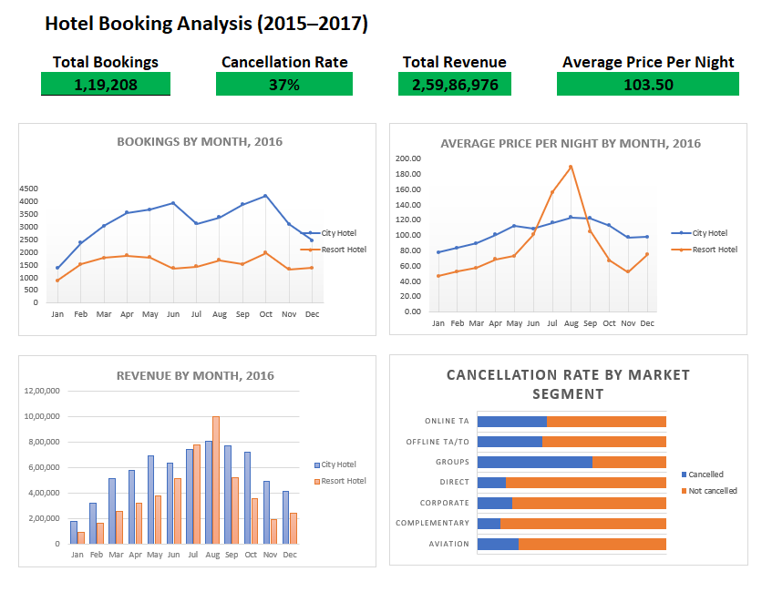

# Hotel Booking Analysis (Excel)

An end-to-end data analysis project in Microsoft Excel: cleaning 119,390 real hotel bookings, analysing cancellations, seasonality, pricing and revenue, and turning the findings into business recommendations.

## Business Questions
1. Which hotel gets more bookings, and which cancels more?
2. Which months are busiest, and do both hotels follow the same seasonal pattern?
3. When are prices highest, and do they rise in the same months as bookings?
4. Which booking channels (market segments) cancel most?
5. Which months and hotels generate the most revenue?

## Dataset
- **Source:** [Hotel Booking Demand](https://www.kaggle.com/datasets/jessemostipak/hotel-booking-demand) on Kaggle, originally published by Antonio, Almeida and Nunes (2019), *Data in Brief*
- **Scope:** bookings for a City Hotel and a Resort Hotel in Portugal, July 2015 to August 2017
- **Size:** 119,390 rows; 36 columns in the version used (including 4 added personal-data columns)
- **Prices** (ADR, average daily rate) are assumed to be in euros

## Tools
Microsoft Excel: Excel Tables, Go To Special, IF, XLOOKUP, DATEVALUE, COUNTIF, PivotTables, PivotCharts, and a dashboard with KPI cards.

## Process

### 1. Data cleaning (documented in the `cleaning_log` sheet)
| Issue | Count | Decision |
|---|---|---|
| Missing country | 488 | Filled with "Unknown" |
| Missing agent | 16,280 | Filled with "No Agent" (booked without an agent) |
| Missing company | 112,440 | Filled with "No Company" (94% empty, not analysed) |
| Missing children | 4 | Filled with 0 |
| Negative price (-6.38) | 1 | Removed: impossible value |
| Extreme price (5,400; next highest 510) | 1 | Removed: likely data-entry error |
| Bookings with 0 adults, 0 children and 0 babies | 180 | Removed: no guests |
| Zero price | 1,959 | Kept for booking counts (680 are Complementary stays); excluded from price averages |
| Personal data (name, email, phone, card) | 4 columns | Removed from the working data: not needed for analysis |
| Identical rows (after removing personal data) | 31,980 | Kept: no booking ID exists, so identical rows may be separate genuine bookings |

**Final clean dataset: 119,208 rows.** Missing-value counts dropped slightly after the 182 invalid rows were removed, and all counts were reconciled.

### 2. Calculated columns
`total_nights`, `total_guests`, `booking_status`, `revenue` (price x nights, non-cancelled bookings only), `arrival_date`, `adr_paid` (price excluding free stays) and `season` (via XLOOKUP).

### 3. Analysis
Pivot tables and charts for bookings, cancellations, prices and revenue by hotel, month and market segment. **Monthly patterns use 2016 only**, because 2015 and 2017 are partial years, and combining years would count July and August three times but other months only twice.

## Key Findings
| # | Finding | Evidence |
|---|---|---|
| 1 | City Hotel cancels far more than Resort Hotel | 41.8% vs 27.8% cancellation rate |
| 2 | Group bookings cancel the most | 61% of group bookings cancelled vs 15% of direct bookings (excluding the tiny "Undefined" segment) |
| 3 | Summer earns the most, but is not the busiest season | 2016 revenue peaked in August and July, while bookings peaked in October, April and May |
| 4 | Resort bookings are worth more per booking | Resort Hotel had about 33% of 2016 bookings but about 41% of 2016 revenue; its average price ranged from 47 (January) to 189 (August) |
| 5 | January is the weakest month at both hotels | Lowest bookings, prices and revenue in 2016 |

## Recommendations
1. **Reduce cancellations where risk is highest:** deposits and a 30-day cut-off date for group bookings, and a non-refundable rate option at City Hotel, while keeping flexible terms for low-risk direct and repeat guests.
2. **Price for demand:** keep premium summer pricing, and raise prices moderately in busy months like April, May and October.
3. **Grow the most valuable bookings:** focus summer marketing and longer-stay packages on Resort Hotel.
4. **Fill the off-season:** winter promotions such as packages, long-stay deals and corporate offers.
5. **Test and measure:** trial any new policy and track whether cancellations fall without reducing bookings.

## Dashboard KPIs (all bookings, 2015 to 2017)
- Total bookings: **119,208**
- Cancellation rate: **37%**
- Total revenue (non-cancelled stays): **25,986,976**
- Average price per night (excluding free stays): **103.50**

## Limitations
- No booking ID, so true duplicates cannot be confirmed.
- Revenue is estimated as price x nights and excludes extra spending.
- Only two hotels in one country, so results may not generalise.
- Booking counts by month include cancelled bookings.

## Files
- `hotel_booking_analysis.xlsx`: sheets for `Dashboard`, `raw_data`, `clean_data`, `cleaning_log`, `analysis`, `QA` and `findings`
- `dashboard.png`: dashboard screenshot

## Author
**Vinoth Rao M**: [LinkedIn](https://linkedin.com/in/vinothmadhavarao) | [GitHub](https://github.com/vinothmadhavarao)
